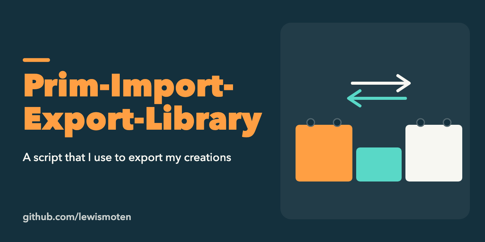

# Prim-Import-Export-Library

Scripts in Linden Scripting Language (LSL) for exporting objects ("prims") from Second Life and rebuilding them elsewhere, written in 2015.

- `GetPrimParameters.lsl` and `ImportGenerator.lsl`: read a prim's parameters and generate code to recreate it.
- `import-export/`: the source and destination scripts, plus a [readme](import-export/readme.md) with a video demonstration of how to use them.

Only export objects you created or have permission to copy. Not maintained.
